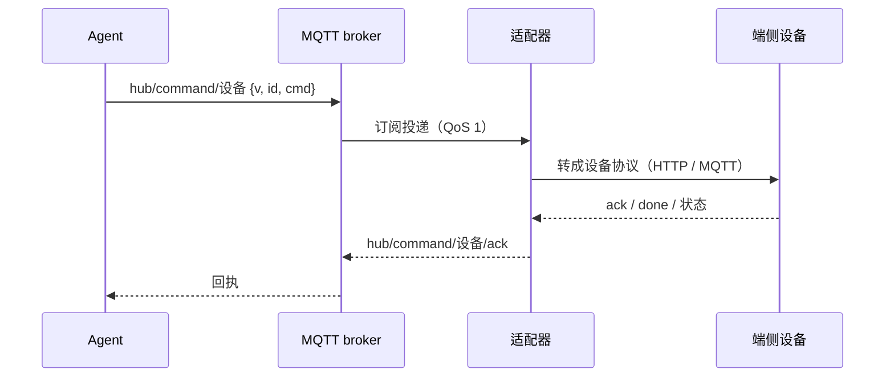

# Agent-Ops-Edge-Hub

**基于 MQTT 的边缘通信底座 —— 把 Agent 的意图转成设备的真实动作。**

🔗 **三件套** · [🔌 数据面（本仓）](https://github.com/Ly-Systems-Lab/Agent-Ops-Edge-Hub) · [🔭 总蓝图 · Architecture](https://github.com/Ly-Systems-Lab/Agent-Ops-Architecture) · [🧠 控制面 · WeCom-Bridge](https://github.com/Ly-Systems-Lab/Agent-Ops-WeCom-Bridge)

> **🎯 它是用来干嘛的？**
>
> 当 AI Agent 走出屏幕，它需要的不仅是算力，更是一副能安全交互的物理躯体。
> 本仓（Edge-Hub）就是 Agent-Ops 架构的「数字神经与肌肉」：一台树莓派上的常驻中控，
> 基于 MQTT，把 Agent 飘忽不定的意图，转化为**可靠、安全、隔离**的物理动作。
>
> **控制面管「人怎么指挥 Agent」，本仓管「Agent 怎么指挥设备」。**

| 仓 | 角色 | 一句话 | 状态 |
|---|---|---|---|
| **本仓** · [`Agent-Ops-Edge-Hub`](https://github.com/Ly-Systems-Lab/Agent-Ops-Edge-Hub) | **数据面** · Agent ⇄ 物理世界 | 基于 MQTT 的边缘通信底座：把 Agent 的意图转成设备的真实动作 | 已公开 |
| [`Agent-Ops-WeCom-Bridge`](https://github.com/Ly-Systems-Lab/Agent-Ops-WeCom-Bridge) | **控制面** · 人 ⇄ Agent | 把企业微信变成 Agent 的调度台：流式交互、进度管控、权限拦截 | 已公开 |
| [`Agent-Ops-Architecture`](https://github.com/Ly-Systems-Lab/Agent-Ops-Architecture) | **总蓝图** | 分布式具身智能的顶层设计、《协同宣言》与人机协同约定 | 已公开 |

**控制面与数据面彻底解耦** —— 两个仓之间不互相调用，只共享同一套约定
（同一个 Agent 概念、同一个路由原则、同一条留痕要求）。

---

## 物理世界数据面规约

> 总蓝图仓那份[《协同宣言》](https://github.com/Ly-Systems-Lab/Agent-Ops-Architecture/blob/main/docs/manifesto.md)
> 讲的是「人怎么用 AI」。数据面面对的是另一件事：
> **代码写错不会死，设备动作写错会。**
>
> 所以这里不搬宣言，只留三条铁律。每条都配有可检验的判据 —— 代码可以重构，但物理定律不可妥协。

### 一 · 可靠：每个动作都有回执，每次断连都能自愈

**发出去不等于做到了。** 指令下发后必须能拿到"成没成"；拿不到就如实报错，
不能默认成功 —— 否则人看到的是"已完成"，设备其实没动。

**为什么**：物理世界的动作**不可回滚**，重发一次只会多执行一次；
而"没反应"和"成功了"在人眼里长得一样。

**怎么检验**：同一条指令重复投递只执行一次（去重）；拿不到回执回明确的错误码，
不静默超时；单个进程挂了能自己回来（`Restart=always` + 自动重连）；
总线断了，设备仍能做完本来会做的事。

### 二 · 安全：唯一被信任的通道，是窄而确定的

**默认不信任任何设备。** 设备通道只走 TLS 1.2 + 双向证书 + 账号密码 +
按主题收窄的 ACL；明文口只绑回环，出不了这台机器。

**为什么**：端侧设备是"被指挥的一方"，它暴露在局域网里、可能被拆开、可能被换掉。
凭据泄露不该等于整台中控被接管。

**怎么检验**：没有客户端证书连不上 8883；每台设备只能读写自己的主题，
看不见别人的消息；1883 从局域网任何机器都连不上。

### 三 · 隔离：一台设备的失败，关在它自己的主题里

**不做「万能路由」。** 每台设备一个适配器进程；走 MQTT 的设备再各有一套凭据和
ACL 角色，主题空间互不重叠。一台设备被攻破或写坏，影响面锁死在它自己的主题内。

**为什么**：设备天然异构（小电视走 HTTP、P4 走 MQTT 对话、小车要异步回执），
强做通用层只会得到分支堆砌；而一个持有所有设备凭据的进程，攻破即全失。

**怎么检验**：新增设备只加「一个适配器目录 + 一个 systemd 单元」
（走 MQTT 的设备再加一个 ACL 角色），核心代码不动；删掉一台不影响其余链路。

> 全文与取舍依据：**[docs/DATA-PLANE-CHARTER.md](docs/DATA-PLANE-CHARTER.md)**。

---

## 逻辑闭环

一条指令从 Agent 到设备、再从设备回到 Agent，必须**首尾相接**。
下图之外的事（谁下指令、Agent 怎么想）不归数据面管。



| 环节 | 靠什么闭环 | 断了会怎样 |
|---|---|---|
| 指令下发 | QoS 1 + 同一 `id` 去重 | 网络重试不会让设备执行两次 |
| 设备执行 | 设备侧回执（ack / done） | 拿不到回执 ⇒ 明确报超时，不假装成功 |
| 状态回传 | P4 的 `hub/device/p4/status` 置 retained | 新订阅者立刻拿到最后状态 |
| 进程存活 | systemd `Restart=always` + 退避重连 | 单个服务挂掉不影响其它链路 |
| 设备自治 | 固件不依赖总线存活 | 总线断了，设备仍能做本来会做的事 |

**三条流，各自独立**：告警（上游 → 推送）、指令（入口 → 设备）、回执（设备 → 入口）。
通过 MQTT 解耦，任一端重连不影响其它。

> 逐环详解、可靠性机制清单与架构边界：**[docs/ARCHITECTURE.md](docs/ARCHITECTURE.md)**。

---

## ⚠️ 物理安全与边界（Boundaries & Safety）

**这一节不是免责声明，是使用前提。** 与物理世界交互，先把边界划清楚。

| 它是什么 | 它不是什么 |
|---|---|
| 受信任局域网内的**家用 / 桌面中控底座** | ❌ 生产级系统：无冗余、无 SLA、无故障演练 |
| **参考实现**：约定与代码都可照抄 | ❌ 通过任何安全认证或工业标准 |
| 端侧设备的**适配器集合** | ❌ 通用 MQTT 框架：设备接入**按设备定制**，不做代码层通用路由 |
| 让 Agent **下发指令并拿到回执** | ❌ 安全回路：**不能**用来驱动高压、动力机械等有安全风险的执行器 |

🔴 **必须知道的五条：**

1. **物理动作不可回滚。** 指令重发不会"更准"，只会多执行一次。
   本仓做幂等与冷却，但**最终责任在使用者**。
2. **AI 会出错。** 指令来自 Agent / 大模型，可能幻觉、可能延迟。
   **请务必在人类监督下使用**；因 AI 幻觉或网络延迟导致的设备损坏或数据泄露，概不负责。
3. **HTTP 端口没有认证。** `5000` 只有 IP 白名单，是**唯一**那道门。
   仅限受信网段 + 绑设备固定 IP；**绝不要转发到公网**。
4. **本仓不含固件与硬件资料。** ESP32 固件、外壳、接线属于设备本身，不在本仓。
5. **有动力 / 高压部件的设备，必须保留独立的物理急停（E-Stop）。**
   软件协议（包括本仓）**不是安全回路** —— 急停是任何软件都无法替代的最后防线。

> 安全边界、ACL 全文与加固路线：**[docs/SECURITY.md](docs/SECURITY.md)**。

---

## 快速上手

前置：树莓派（已在 Pi 5 / Debian 12 / Python 3.11 验证）+ `sudo apt install -y mosquitto mosquitto-clients`。

```bash
git clone <本仓地址> /home/pi/cooperate/pihub && cd /home/pi/cooperate/pihub
python3 -m venv .venv && .venv/bin/pip install -r requirements.txt
cp .env.example .env && chmod 600 .env      # 填企微凭据、设备 IP、http_allow
.venv/bin/python app/init_db.py && mkdir -p logs

# 最简：只给本机服务用（不接外部设备）
sudo cp config/mosquitto-localonly.conf /etc/mosquitto/conf.d/pihub.conf
sudo systemctl restart mosquitto

sudo cp systemd/*.service /etc/systemd/system/
sudo systemctl daemon-reload
sudo systemctl enable --now pihub-api pihub-devctl pihub-monitor pihub-wecom-bot
./acceptance_s9.sh check
```

🔴 **`http_allow` 默认只含 `127.0.0.1`**，照抄不改 ⇒ 设备取数 **403**，
而返回体为空（屏幕只表现为"一直空白"，看不出是权限问题）。
必须写成 `http_allow=127.0.0.1,<你的设备IP>`。

- **接外部设备**（TLS + 双向证书 + ACL）是**一整套**，缺一样 mosquitto 就起不来：
  见 [`config/mosquitto-pihub.conf`](config/mosquitto-pihub.conf) 与
  [DEPLOY.md §5](deploy/DEPLOY.md#5-mosquittobroker)。
- **从零部署的完整步骤**（证书生成、白名单、P4 适配器）：
  [DEPLOY.md §11 复现步骤](deploy/DEPLOY.md#11-复现步骤从零到跑起来)。
- **接 ESP32-P4 面板**：[`p4-agent/README.md`](p4-agent/README.md) 与
  [`docs/P4-PI-AGENT-SPEC.md`](docs/P4-PI-AGENT-SPEC.md)。

---

## 索引

### 代码与配置

| 路径 | 内容 |
|---|---|
| [`app/`](app/) | Pi 侧全部 Python 代码（api / devctl / monitor / wecom_bot / p4_bot / car_bot …） |
| [`config/`](config/) | Mosquitto 配置与 ACL 样例（**脱敏，无真实凭据**） |
| [`systemd/`](systemd/) | 6 个 systemd 单元（`p4-agent` 的单元在它自己的目录里） |
| [`p4-agent/`](p4-agent/) | ESP32-P4 ↔ OpenClaw Agent 桥接适配器（独立服务，最小完整样本） |
| [`ai-agent-wecom/`](ai-agent-wecom/) | 把 AI Agent 接入企业微信的教程（可复现，含实拍） |
| [`docs/`](docs/) | 接入契约、交接文档、架构 / 安全 / 规约 |
| [`deploy/DEPLOY.md`](deploy/DEPLOY.md) | 部署实况台账：单元、端口、配置键、设备清单 |
| [`acceptance_s9.sh`](acceptance_s9.sh) | S9 验收脚本（只能在 Pi 上跑） |
| [`.env.example`](.env.example) | 环境变量样例（**值全空**） |

> ★ **`wecom_bot.py` 身兼两职**：`pihub-wecom-bot` 跑的是它（小电视链路）；
> `p4_bot.py` / `car_bot.py` 又继承它当基类。看到 `from wecom_bot import WeComBot` 时，
> 它是**被复用的库**，不是启动服务。

### 继续往下读

| 想知道什么 | 去哪 |
|---|---|
| 这套东西为什么长这样、边界在哪 | [docs/ARCHITECTURE.md](docs/ARCHITECTURE.md) |
| 可靠 / 安全 / 隔离分别怎么落地 | [docs/DATA-PLANE-CHARTER.md](docs/DATA-PLANE-CHARTER.md) |
| 安全边界、ACL、HTTP 加固路线 | [docs/SECURITY.md](docs/SECURITY.md) |
| 从零部署、端口、配置键 | [deploy/DEPLOY.md](deploy/DEPLOY.md) |
| P4 的主题 / 报文 / 超时契约 | [docs/P4-PI-AGENT-SPEC.md](docs/P4-PI-AGENT-SPEC.md) |
| P4 侧已实现到什么程度 | [docs/P4-PI-HANDOFF.md](docs/P4-PI-HANDOFF.md) |
| 企微机器人怎么建、怎么接 | [ai-agent-wecom/README.md](ai-agent-wecom/README.md) |
| 三件套的顶层设计与协同约定 | [Agent-Ops-Architecture](https://github.com/Ly-Systems-Lab/Agent-Ops-Architecture) |

运行时生成、**不进仓**：`data/pihub.db`、`logs/*.log`、`backup/`、`.venv/`、任何 `*.key` / `*.crt`。

---

## 许可

**Apache License 2.0** —— 全文见 [`LICENSE`](LICENSE)。

作为连接数字与物理世界的数据面底座，我们深知底层基础设施的重要性。
在遵守许可证条款的前提下，你可以自由使用、修改、分发本项目（包括商业用途），
甚至将其闭源集成到你的商业产品中。我们唯一的期望是：
**保留原作者的版权与许可声明。**

**我们开源的不仅是一套通信协议，更是 AI 安全通往物理世界的底层轨道。**
期待这套底座，能成为具身智能时代坚实的数字神经。
