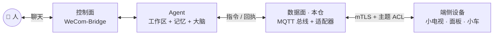
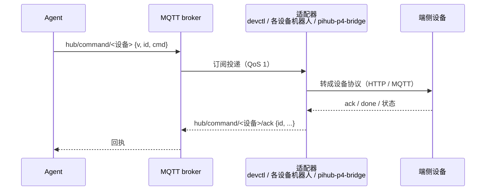

# 数据面架构与逻辑闭环

> 本文件回答三件事：**这一层在哪、一条指令怎么闭环、边界划在哪。**
> 对外门面见 [README](../README.md)，部署实况见 [deploy/DEPLOY.md](../deploy/DEPLOY.md)。

---

## 一、这一层在哪

| 面 | 仓 | 管什么 |
|---|---|---|
| **控制面** | [`Agent-Ops-WeCom-Bridge`](https://github.com/Ly-Systems-Lab/Agent-Ops-WeCom-Bridge) | 把企微当作 Agent 的入口：消息 ⇄ Claude Code / OpenClaw |
| **数据面（本仓）** | [`Agent-Ops-Edge-Hub`](https://github.com/Ly-Systems-Lab/Agent-Ops-Edge-Hub) | 把 MQTT 当作设备的入口：指令 ⇄ 端侧设备 |
| 总蓝图 | [`Agent-Ops-Architecture`](https://github.com/Ly-Systems-Lab/Agent-Ops-Architecture) | 只放架构文档与人机协同基准 |

**分工一句话**：控制面管「人怎么指挥 Agent」，数据面管「Agent 怎么指挥设备」。
两个仓合起来，才是完整的「人 ⇄ Agent ⇄ 物理世界」这条路径。

数据面本身**不产生意图**。它的职责只有两件：把意图**送进物理世界**，
再把结果**带回可观测的状态**。

### 常驻服务（7 个：`core/` 1 个 + `devices/` 6 个）

| 服务 | 脚本 | 干什么 |
|---|---|---|
| `pihub-api` | [`devices/smalltv/http_api.py`](../devices/smalltv/http_api.py) | Flask HTTP 接口（`:5000`，**IP 白名单**），供 ESP32 与外部调用 |
| `pihub-devctl` | [`devices/smalltv/devctl.py`](../devices/smalltv/devctl.py) | 订阅 `hub/command/smalltv`（**只这一个**），转成设备 HTTP 指令 |
| `pihub-monitor` | [`core/monitor.py`](../core/monitor.py) | 行情轮询 → 涨跌停 / 异动告警 → `hub/alert/#` |
| `pihub-wecom-bot` | [`devices/smalltv/bot.py`](../devices/smalltv/bot.py) | 企微智能机器人双向：收消息下发指令 / 推告警（小电视） |
| `pihub-p4-bot` | [`devices/p4/bot.py`](../devices/p4/bot.py) | P4 专属机器人：中文指令 → `hub/command/p4` |
| `pihub-p4-bridge` | [`devices/p4/bridge.py`](../devices/p4/bridge.py) | P4 面板 ↔ OpenClaw Agent 桥接（MQTT → Gateway 流式） |
| `pihub-car-bot` | [`devices/car/bot.py`](../devices/car/bot.py) | 小车专属机器人：中文指令 → `hub/command/car` |

> ⚠️ **每个机器人 = 一个独立企微账号 = 一对独立凭据**（`WECOM_*` / `P4_WECOM_*` / `CAR_WECOM_*`）。
> 复用同一对凭据会让「这条消息该谁处理」变得不可预测。
>
> 单元清单、路径与开机自启状态：[DEPLOY.md §4](../deploy/DEPLOY.md#4-systemd-实际单元7-个)。

---

## 二、逻辑闭环

一条指令从 Agent 到设备、再从设备回到 Agent，必须**首尾相接**。
下图之外的事（谁下指令、Agent 怎么想）不归数据面管。

### 三条流，各自独立

| 流 | 方向 | 主题 | 谁产出 / 谁消费 |
|---|---|---|---|
| 告警 | 上游 → 人 | `hub/alert/#` | `core/monitor.py` → `devices/smalltv/bot.py`（全通配，新增类型不用改订阅） |
| 指令 | 入口 → 设备 | `hub/command/{smalltv,p4,car}` | `devctl` / 各设备机器人 → 设备 |
| 回执 | 设备 → 入口 | `hub/command/<设备>/ack`、`hub/chat/p4/reply` | 设备 → 机器人 / P4 |

三条流通过 MQTT 解耦，**任一端重连不影响其它**。

### 逐环与失效路径

| 环节 | 闭环手段 | 失效时会怎样 |
|---|---|---|
| 下发 | QoS 1；同一 `id` 去重 | 网络重试不会让设备执行两次 |
| 执行 | 设备侧回执 | 拿不到就回超时错误码，不假装成功 |
| 状态 | P4 的 `hub/device/p4/status` 置 retained | 新订阅者立刻拿到最后状态 |
| 进程 | `Restart=always` + 退避重连 | 单个服务崩溃不影响其它链路 |
| 设备 | 固件本地自治 | 总线断开，设备仍能做完本来会做的事 |

### 反控：同一条闭环的另一半

P4 不仅能发消息，也能被 MQTT 反控（`music` / `aichat` / `close_all`）。
命令走 `hub/command/p4`，回执走 `hub/command/p4/ack`，与上行对话共用同一套 ACL 与凭据。
契约见 P4 仓 [mqtt-contract.md §11](https://github.com/Ly-Systems-Lab/Agent-Ops-P4-Terminal/blob/main/docs/mqtt-contract.md#11-反控命令)。

**反控的主体不止 Pi 侧。** 任何持有独立凭据的接入方 —— 另一台电脑上的 Agent、
你自己的服务 —— 只要 broker 给它一段授权，就能指挥对应的端侧设备。
这不是"多开一个口子"，而是同一套模型的延伸：

| 谁 | 凭什么能控 | 边界在哪 |
|---|---|---|
| Pi 侧机器人 | 本机回环账号 | 进程边界 |
| 外部接入方 | 独立证书 + 独立 ACL 角色 | **broker 的授权表** |

⇒ **能力边界由 ACL 决定，不由接入方的自觉决定**；想收回，改一行 ACL，
不必去设备上动任何东西。参考实现：[`win-agent/`](../win-agent/)。

---

## 三、可靠性机制清单

**下面每一条都是实装的，不是设计稿。** 「代码依据」一列可直接对照源码。

| 机制 | 代码依据 |
|---|---|
| **进程级自恢复** | 全部 7 个 systemd 单元均 `Restart=always` |
| **QoS 1 全链路** | 指令下发、回执、告警 publish / subscribe 一律 `qos=1` |
| **断线重连** | paho `loop_start()` 内置自动重连；`pihub-p4-bridge` 额外 `reconnect_delay_set(1, 30)` 指数退避 |
| **信号兼容** | `pihub-p4-bridge` 用 `loop_start` + 事件等待而非 `loop_forever`，保证 `systemctl stop` 能跟手退出（否则必然超时） |
| **告警冷却持久化** | `core/monitor.py` 的冷却写 SQLite，**重启不重推**；且只在确认发出后才记冷却，断连时留给下一轮重试 |
| **重复下发去重** | `devices/smalltv/devctl.py` 对同一 `id` 重复指令只执行一次，回执标「重复下发，未再次执行」 |
| **帧大小防线** | `pihub-p4-bridge` 硬限 `MAX_FRAME_BYTES=4096`，超限不静默丢弃，而是降级发最小错误帧 |
| **会话保活 / 超时** | `pihub-p4-bridge` 用 keepalive 帧 + 硬超时（`HARD_TIMEOUT_SEC`），超时回 `agent_timeout` 错误码 |
| **并发闸** | `pihub-p4-bridge` 严格串行（`MAX_CONCURRENT=1`），防连点打满后端 |
| **入口隔离** | MQTT 连不上只告警，**绝不拖垮语音 / 业务主循环** |

> 💡 **为什么是这些机制**：物理动作不可回滚。重发不会"更准"，只会多执行一次 ——
> 所以可靠性不是"尽量不出错"，而是**出错时能被看见、能被收住**。

---

## 四、架构边界（核心不认识任何设备）

**主张只有一条：一切皆插件。** 分清哪层通用、哪层按设备定制，才好判断适不适合你：

| 层 | 是什么 | 通用？ |
|---|---|---|
| **A. 端侧接入（插件）** | 每台设备一个自包含目录，填同一张六格表（主题 / 解析 / 渲染 / 凭据 / 目标 / 单元） | ✅ **边界通用**；指令与报文由插件自定 |
| **B. Agent ↔ 设备互联** | Agent 经 MQTT / HTTP 与设备双向互通（P4 已跑通：MQTT → Gateway 流式 → 回推） | 结构可复用，接入需定制 |
| **C. 企微机器人分层管理** | 企微作统一交互入口，可接任意 Agent / 端侧设备，各建机器人 | ⚠️ **交互级通用；指令集须按设备自定** |

> **通用的是「边界与生命周期」，定制的是「指令与报文」。**
> 每个插件都填同一张六格表 —— 抽象的是**形状**，不是**语义**。

⚠️ **C 层的「通用」是「交互级通用」，不是「指令级通用」：**

- ✅ **交互级（通用）**：企微机器人作为**统一入口**，你可以接入**任何 Agent 或端侧设备**，
  并为它们建对应的机器人。告警 → 推送的通道（`hub/alert/#` 全通配）也现成，
  新增告警类型不用改订阅。
- ⚠️ **指令级（必须自己定）**：**每台设备的指令集得使用者按自己的端侧设备定义。**
  给小电视发"左转" / 给小车发"切换壁纸"，两边都会懵。
  本仓 `devices/smalltv/command.py` 解析的 `set_mode` / `set_brightness` / `set_wallpaper` 全是小电视专用；
  换设备必须重写解析。
- ⚠️ **推送单目标**：`get_target_chat()` 一次只推一个会话，没有按类型分流。

### 为什么是插件，而不是一个大而全的适配器

1. **爆炸半径** —— 每台设备独立进程 + 独立证书 + 独立 ACL 角色，
   一台被攻破只影响它自己，**爆炸半径物理隔离**；反之一人持所有凭据，攻破即全失。
2. **改动半径** —— 指令集、报文格式、超时规则都是**设备的怪癖**，就放在设备目录里。
   核心不必为每台设备长分支，新增设备也不去碰核心。

**指令与契约归设备，不归核心。** P4 的五条硬约束（4 KB / `id` 回传 / `final` 恰好一次 /
20 s 保活 / 不 retained）是为那块屏定的；换一块屏就重定，**定在新目录里**，
不是塞进核心让核心被单一设备的怪癖污染。

### 传输方式是选型，不是架构

| 设备形态 | 推荐 | 理由 |
|---|---|---|
| 低性能 MCU | HTTP（被推） | 省掉长连接与重连状态机，固件里最紧的就是这部分 |
| 跑得动 MQTT 的设备 | MQTT | QoS 1、按主题收窄的 ACL、与其余设备同一套总线 |

MQTT 强行套到低性能 MCU 上也**能做**，只是不划算 —— 那是资源账，不是架构账。
⇒ **一台走 HTTP 的设备当插件，和一台走 MQTT 的设备当插件，在架构上是同一件事。**
把"不做通用路由"读成"所以做不到插件化"，是读反了。

**代码层的现状**：分工已经落到目录上 —— `core/` 只保留**与设备无关**的
行情 / 天气 / 企微基类 / MQTT 守卫；每台设备一个自包含目录
（[`devices/smalltv/`](../devices/smalltv/)、[`devices/p4/`](../devices/p4/)、
[`devices/car/`](../devices/car/)），主题、指令解析、回执渲染、凭据键、推送目标键
全在各自目录里。**加一台设备 = 加一个目录，核心零改动** ——
[`devices/_template/`](../devices/_template/) 就是这个判据的可执行形式。
契约见 [DEVICE-PLUGIN.md](DEVICE-PLUGIN.md)，验收判据见其 §六。

完整论证与代码证据：[DEPLOY.md §9.1](../deploy/DEPLOY.md#91--架构定位核心不认识任何设备一切皆插件)。

### 接入你自己的端侧设备

**不要**改 `core/`（那里是行情 / 天气 / 企微基类，与设备无关）—— 新设备写在自己的目录里。推荐路径：

1. **复制 [`devices/_template/`](../devices/_template/)** —— 空壳已填好骨架
   （连上 → 订阅 → 解析 → 执行 → 回执），要改的六处都标了 `TODO`；
   [`devices/p4/`](../devices/p4/) 是填好的完整样本（含保活 / 去重 / 超时 / 错误码全套）。
2. **更省事的做法：让你的 Agent 帮你写**。把 P4 仓的
   [mqtt-contract.md](https://github.com/Ly-Systems-Lab/Agent-Ops-P4-Terminal/blob/main/docs/mqtt-contract.md)
   和 `devices/_template/` 一起喂给 Claude Code / OpenClaw 等，说明你设备的通信方式，
   让它生成同构适配器。**这是本项目的设计假定：接入工作交给 Agent，人只负责验收。**
3. **新设备只动两 / 三处**：新建 `devices/<设备>/` 目录 + 自己的 systemd 单元；
   **走 MQTT 的设备再加** `config/aclfile.example` 一段 `user <角色>` 与
   `mosquitto_passwd` 一个账号（走 HTTP 的设备不需要）。

> 代价是「每接一台要写一次」，收益是**每台设备的失败都关在自己盒子里**。
> 对受信任局域网内的家用 / 桌面中控场景，这个交换是划算的。

---

## 五、已知限制

写得出来，才说明真的想过。

| 限制 | 说明 |
|---|---|
| **P4 无用户鉴权** | `hub/chat/p4` 靠 mTLS + ACL 做「设备级信任」，不是「用户级鉴权」—— 拿到 P4 的人就能对 Agent 说任何话。家庭内部可接受，带出门需评估 |
| **HTTP 无认证** | `5000` 只有 IP 白名单，没有 token / 签名。仅限受信网段 + 绑设备固定 IP |
| **推送单目标** | `get_target_chat()` 一次只推一个会话，没按告警类型分流 |
| **一进程一设备** | `devices/*/` 的适配器一个进程只订阅自己的主题；**同型号的第二台**要再起一个 unit 实例（换 `DEVICE_ID`）。这是刻意的：爆炸半径隔离优先于省进程 |
| **回执扫描有复制** | 三个 bot 共用基类，但 `_sweep_pending`（超时话术按设备不同）与扫描线程在 P4 / 小车目录里各有一份；抽成「基类钩子 + 只覆写话术」尚未做 |
| **固定会话会累积** | `pihub-p4-bridge` 的会话 ID 固定为 `conv:<DEVICE_ID>-main`，历史持续累积；要清空须重启 Gateway 或换 `DEVICE_ID` |
| **主机名校验关闭** | `pihub-p4-bridge` 用 `check_hostname=False` + `tls_insecure_set(True)`，因为内网 IP 会变。靠 CA 链 + 双向证书保证；**不建议用于公网** |
| **无冗余 / 无 SLA** | 单机部署，没有故障演练。这是参考实现，不是生产级系统 |

---

## 六、继续往下读

| 想知道什么 | 去哪 |
|---|---|
| 三条规约（可靠 / 安全 / 隔离）的全文 | [DATA-PLANE-CHARTER.md](DATA-PLANE-CHARTER.md) |
| 安全边界、ACL 全文、HTTP 加固路线 | [SECURITY.md](SECURITY.md) |
| 从零部署、端口、配置键、设备清单 | [DEPLOY.md](../deploy/DEPLOY.md) |
| 怎么接一台新设备（插件边界与六格表） | [DEVICE-PLUGIN.md](DEVICE-PLUGIN.md) |
| P4 的主题 / 报文 / 超时契约 | P4 仓 [docs/mqtt-contract.md](https://github.com/Ly-Systems-Lab/Agent-Ops-P4-Terminal/blob/main/docs/mqtt-contract.md) |
| 外部接入方怎么安全反控设备 | [`win-agent/`](../win-agent/) |
| 三件套的顶层设计与协同约定 | [Agent-Ops-Architecture](https://github.com/Ly-Systems-Lab/Agent-Ops-Architecture) |